<p align="center">
  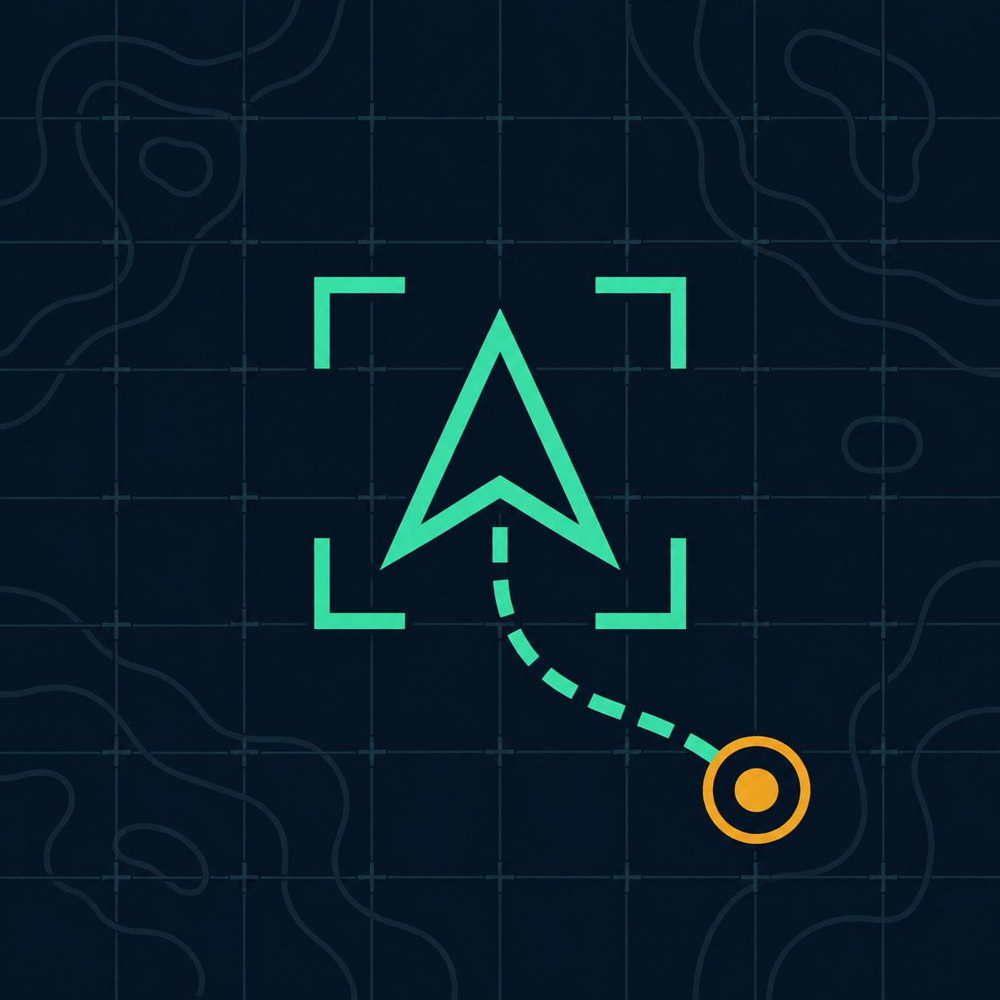
</p>

<h1 align="center">Ground Control (RTS)</h1>

<p align="center"><b>An RTS command layer for Nuclear Option.</b></p>

Pull the camera off your aircraft and command the whole battlefield: select units, queue routes,
give attack orders, build an economy, task aircraft and capture airbases. Then drop back into a
cockpit and fly the war you just planned.

It works on the base game's own missions, ships with missions
of its own, and has an enemy commander that earns, buys, builds and flies against you on the same
rules you play by.

## Tutorial

A full tutorial video for all you need to know:

[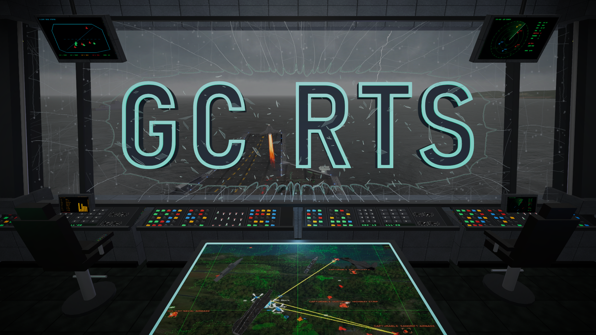](https://youtu.be/QotaeER3wRk)

Follow development on YouTube: **[youtube.com/@needyboxman/posts](https://www.youtube.com/@needyboxman/posts)**

## Community

Join us on **[Discord](https://discord.gg/F5DGy9ystd)**.

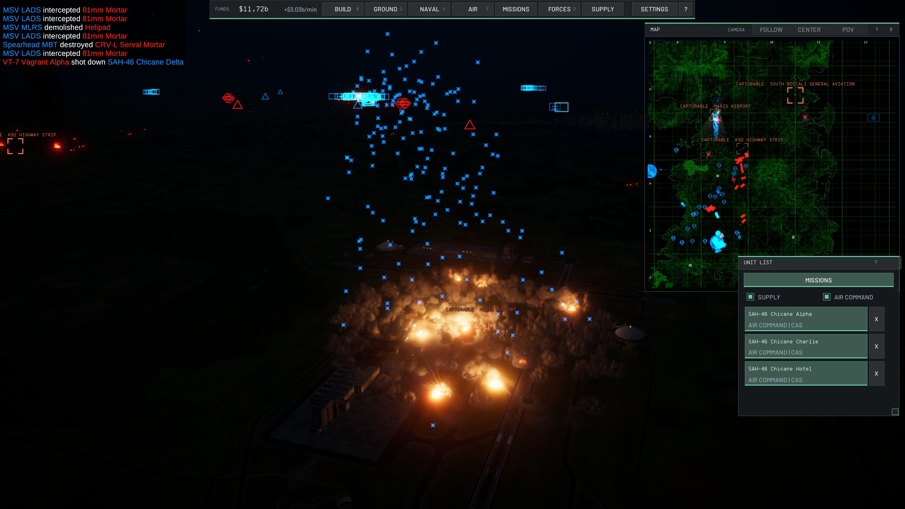

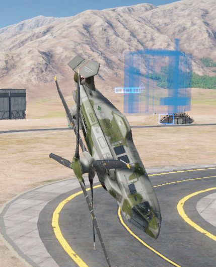

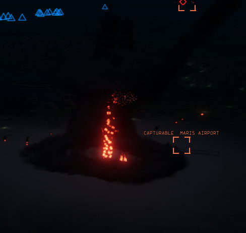

## Features

- **Command:** box select, control groups, multi-point routes, attack orders, stances and pings.
- **Production:** buy ground units at depots and ships at naval docks.
- **Economy:** income buildings, factories, fuel and ammunition stores, and builders to put it all up.
- **Air Command:** launch, task and land aircraft, with loadouts and cargo runs.
- **Capture:** take airbases with ground units or air assaults.
- **Enemy commander:** an AI opponent with its own economy, air force and difficulty levels.
- **Rules your way:** unit caps, unit bans, game speed and your own prices.
- **Mission editor:** tick Ground Control RTS in a mission's parameters to make your own map.

## Gallery

**Rescue**

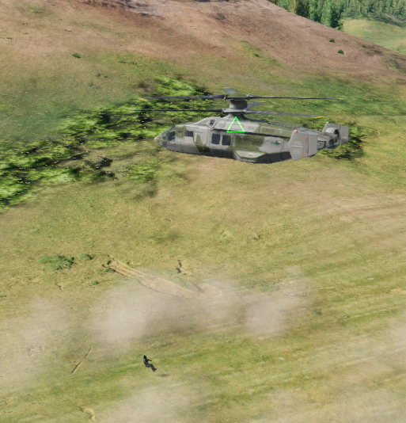

**SAM sites**


**Multi-point routes**

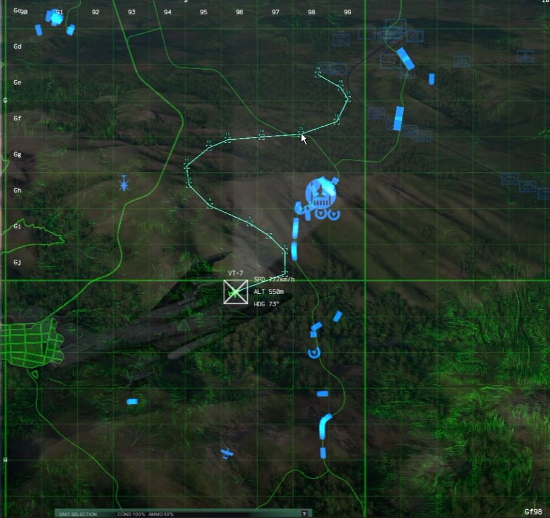

**Tomfoolery**


**Pings**

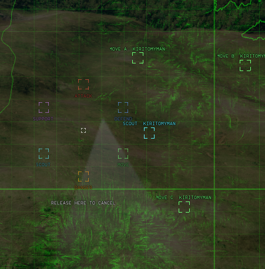

**Nuclear enrichment**


**Air Command**

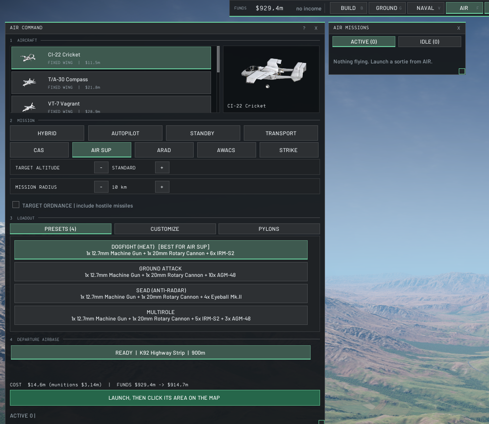

**Landing zones**

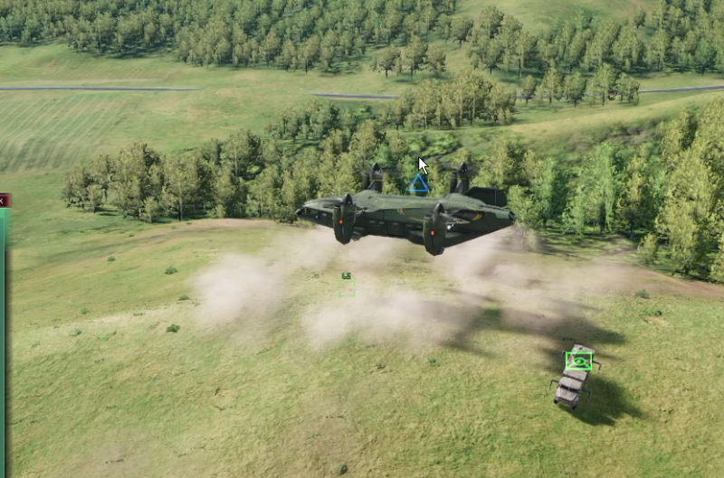

**Base defense**

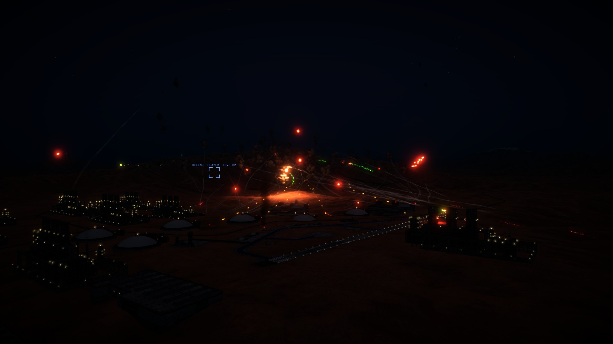

**Artillery**

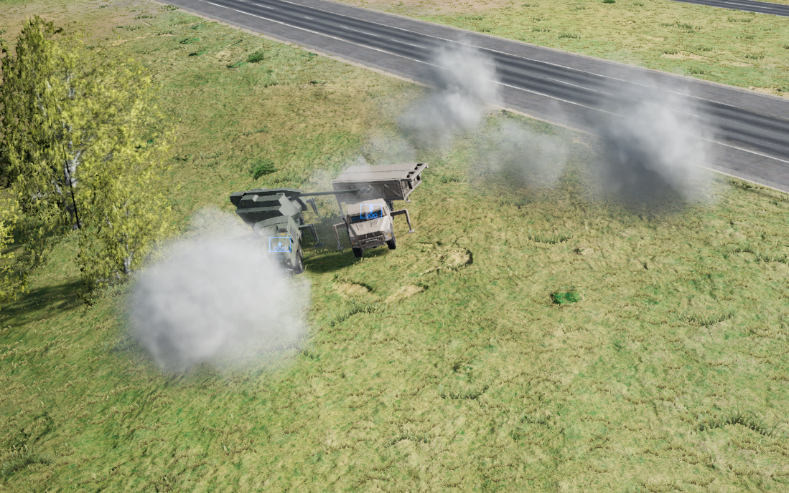

**Artillery site**


**Attack orders**

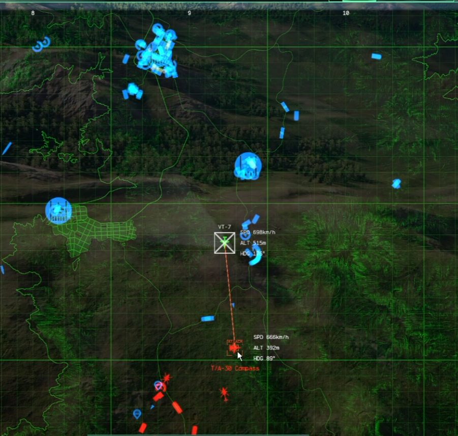

## Missions

These install into your mission list the first time the mod loads.

| Mission | What it is |
| --- | --- |
| Ground Control Tutorial | Start here: the duel's map, played as a lesson |
| Ground Control Duel | 1v1, base against base |
| Ground Control Team Duel | Team battle with neutral airbases to capture |
| Ground Control Team Duel PvE | All players against the AI commander |
| Ground Control Champions | You hold one airbase, the AI holds the rest |
| Ground Control Draft | [IN DEV] No economy: draft your army and fight |

## Requirements

- Nuclear Option
- BepInEx 5

## Installation

1. Download `GroundControlRts.zip` from the latest release.
2. In Steam, right-click Nuclear Option, then Manage, then Browse local files.
3. If there is no `BepInEx` folder, install BepInEx 5 first.
4. Extract the zip into `Nuclear Option\BepInEx\plugins`.

Keep the whole `GroundControlRts` folder, not just the DLL: the missions sit next to it.

Press `F8` in game to enter or leave RTS mode, then play the Ground Control Tutorial.

## Building from source

Requires the .NET SDK and a Nuclear Option installation with BepInEx.

```bash
dotnet build -c Release -p:GameDir="C:\Program Files (x86)\Steam\steamapps\common\Nuclear Option"
```

A Release build also installs the mod into that game folder, so close the game first.

## Contributing and license

Pull requests are welcome, but read **[CONTRIBUTING.md](CONTRIBUTING.md)** first. Changes are listed
in **[CHANGELOG.md](CHANGELOG.md)**, and every unit's price and role is in **[UNITS.md](UNITS.md)**.

The code is source-available and free for non-commercial use. See **[LICENSE](LICENSE)**.
